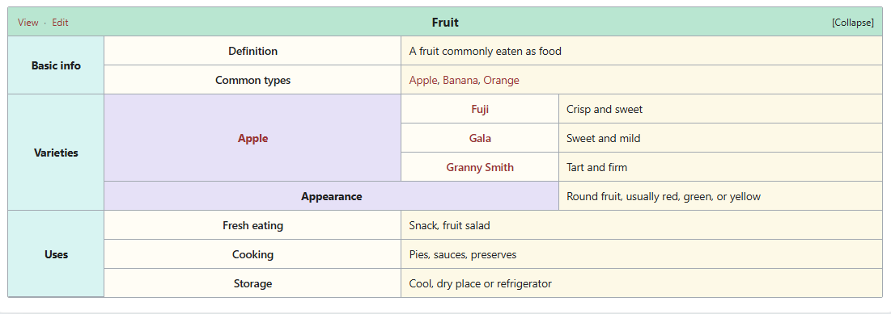

# Wiki Navbox

[English](README.md) | [简体中文](README.zh-CN.md)

A Wikipedia-style collapsible navigation table for Obsidian: **View · Edit** (Talk is hidden by default), two-level groups, `[[wiki links]]`, light and dark themes, and remembered collapse state per code block.



[Full-page preview](docs/preview-en-light.png) · [Dark theme](docs/navbox-en-dark.png)

## Features

- **Wikipedia-inspired table**: mint header, section cells, group columns, label columns, and content cells.
- **Two-level hierarchy**: section → group → rows with automatic `rowspan`, suitable for categories, indexes, and relationship maps.
- **Full Markdown**: `[[wiki links]]`, external links, bold text, and inline code in cells are rendered by Obsidian's native Markdown renderer.
- **Responsive images**: Markdown and wiki image embeds work in cells, titles, and the footer, and are constrained to the column width.
- **Header actions**:
  - View: open the current note in reading view and scroll to the top;
  - Edit: switch the current note to source mode;
  - Talk: hidden by default; when enabled, opens the sibling discussion page and creates it if needed.
- **Remembered collapse state**: stored per code block, or fixed with `collapsed`.
- **Six built-in accents**: `mint`, `sky`, `lilac`, `rose`, `amber`, `slate`, with light and dark values.
- **Localized interface**: choose Auto / English / 简体中文 in settings. Header actions, notices, and errors switch with the UI.
- **Immediate settings**: changing the default accent, compact mode, link color, or header actions re-renders all open navboxes in place.
- **Mobile friendly**: the full table remains scrollable on narrow screens.
- **No network requests**: no note content is collected or uploaded.

## Installation

### Option 1: Download the three files from GitHub Releases (recommended)

Open the repository's **Releases** page, select the latest release, and download these assets separately:

- `main.js`
- `manifest.json`
- `styles.css`

Create this folder in your vault and place all three files inside it:

```text
<your-vault>/.obsidian/plugins/wiki-navbox/
├── main.js
├── manifest.json
└── styles.css
```

Do not rename the files. Restart Obsidian (or reload community plugins) and enable **Wiki Navbox**.

The release page provides the three files individually; no archive is required.

### Option 2: Copy the built plugin

For local development, copy the [`dist/wiki-navbox`](dist/wiki-navbox) folder into the same location.

### Option 3: Open the demo vault

Open [`demo-vault`](demo-vault) as a vault in Obsidian and open its sample note. If Obsidian is in Restricted Mode, disable it under **Settings → Community plugins** and enable **Wiki Navbox**.

## Quick start

Add this to any Markdown note:

````markdown
```wiki-navbox
title: "Fruit"
groups:
  - label: "Basic info"
    rows:
      - [Definition, "A fruit commonly eaten as food."]
      - [Common types, "[[Apple]], [[Banana]], [[Orange]]"]
  - label: "Varieties"
    groups:
      - label: "Apple"
        rows:
          - [Texture, "Crisp and juicy"]
```
````

Reading view renders the navbox; source mode keeps the YAML editable.

You can also run **Wiki Navbox: Insert navbox template**. If text is selected, it is used as the title; otherwise the current note name is used.

A complete English example is available in [`examples/Fruit.md`](examples/Fruit.md).

## Embedding in another note

Use Obsidian's embed syntax `![[ ]]`, not a regular link `[[ ]]`:

- `[[Fruit#Navigation]]`: a normal link to the source note.
- `![[Fruit#Navigation]]`: render the content under the “Navigation” heading in the current note.

### Recommended: embed a heading from the topic page

Add a heading around the navbox in the topic page:

````markdown
## Navigation

```wiki-navbox
title: "[[Fruit]]"
groups:
  - label: "Categories"
    rows:
      - [Common types, "[[Apple]], [[Banana]], [[Orange]]"]
```
````

Then write this in another note:

```markdown
![[Fruit#Navigation]]
```

The navbox is shared, and changes to the source note appear everywhere automatically. See [`examples/Embedding.md`](examples/Embedding.md) for a complete example.

### Standalone navbox note

If you do not want the navbox on the topic page, create a note containing only the navbox, for example `nav/Fruit.md`, and embed the whole note:

```markdown
![[nav/Fruit]]
```

Whole-note embeds do not add a heading. When several notes share a name, use the full path; do not include the `.md` extension.

> If an embed shows only a link or placeholder, make sure you are in Reading view or Live Preview, and that Wiki Navbox is enabled. Source mode only shows `![[...]]` text.

### “View / Talk / Edit” in an embed

Embedded content uses the **source note** as its context:

- Edit opens and edits the source note.
- Internal links resolve relative to the source note.
- To send View or Talk to a different page from a standalone navbox note, set explicit links:

```yaml
links:
  view: "Fruit"
  talk: "Fruit (discussion)"
  edit: "https://example.com/fruit"
```

If `links.edit` is omitted, Edit still opens the source note.

## Syntax

### Indentation

YAML indentation must use **spaces, not tabs**. All examples use **2 spaces per level**:

| Position | Leading spaces |
| --- | --- |
| Top-level `groups:` | 0 |
| Section item `- label:` | 2 |
| Section `rows:` | 4 |
| Section row `- ["Label", "Content"]` | 6 |
| Nested group `- label:` | 6 |
| Group `rows:` | 8 |
| Group row `- ["Label", "Content"]` | 10 |

```yaml
groups:
  - label: "Basic info"        # 2 spaces
    rows:                      # 4 spaces
      - [Definition, Content]  # 6 spaces
  - label: "Varieties"         # 2 spaces
    groups:                    # 4 spaces
      - label: "Apple"         # 6 spaces
        rows:                  # 8 spaces
          - [Texture, Content] # 10 spaces
```

- `label:` follows the `- ` on the same line; it does not need another indentation level.
- `rows:` is two spaces deeper than its container, and rows are two spaces deeper than `rows:`.
- YAML only requires consistent alignment, but this documentation uses 2 spaces. Copy the examples to be safe.
- If Tab inserts a tab character in Obsidian, turn off **Settings → Editor → Indent using tabs** so Tab inserts spaces.

### Sections and rows

`groups` is required. Each section can contain `rows` (direct rows) or `groups` (nested groups).

```yaml
title: "Fruit"
accent: mint
collapsed: false
groups:
  - label: "Basic info"
    rows:
      - ["Definition", "A fruit commonly eaten as food"]
      - ["Common types", "[[Apple]], [[Banana]], [[Orange]]"]

  - label: "Varieties"
    groups:
      - label: "[[Apple]]"
        rows:
          - ["[[Fuji]]", "Crisp and sweet"]
          - ["[[Gala]]", "Sweet and mild"]
      - label: "Appearance"
        value: "Round fruit, usually red, green, or yellow"
```

### Row formats

| Format | Result |
| --- | --- |
| `[Label, Content]` | Label and content |
| `{ label: Label, value: Content }` | Same, useful when content contains commas |
| `{ value: Content }` | Content spans the label columns; no label |
| `"A paragraph"` | Content spans the full row |

Arrays and objects can be mixed. Empty rows and empty objects are ignored.

### Two-level groups

Sections such as `Varieties` can contain `groups`; each group can contain `rows` or a single `value`:

- Group with `rows`: the group label spans its rows, and each row has its own label column.
- Group with only `value`: the group label spans two columns, and the content starts in the last column. Useful for summary rows such as “Appearance”.

Only two levels are supported: section → group → rows. A nested `groups` inside a group produces a clear configuration error.

### Fields

| Field | Type | Default | Description |
| --- | --- | --- | --- |
| `title` | text | `Navbox` | Title; supports Markdown and wikilinks |
| `groups` | array | required | Section list |
| `accent` | text | default accent | `mint` / `sky` / `lilac` / `rose` / `amber` / `slate` |
| `collapsed` | boolean | settings default | `true` starts collapsed; when omitted, the remembered state is used |
| `dense` | boolean | `false` | Compact spacing for this table |
| `footer` | text | none | Small footer text; supports Markdown |
| `links` | object | automatic | Customize header actions; `talk: true` enables Talk per block |
| `sections` | array | none | Alias for `groups` |

### Header actions

The header shows **View · Edit** by default; Talk is hidden. Enable Talk globally in settings, or per block:

```yaml
links:
  view: "Fruit"
  talk: true
  edit: "https://example.com/fruit"
```

`links.talk` priority:

- `true`: show the automatic discussion-page action, even if the global default is off;
- `false`: always hide it, even if the global setting is on;
- a note path: show Talk and open that page;
- omitted: follow **Show Talk button** in settings.

- Values starting with `http://`, `https://`, or `mailto:` open externally.
- Other values are passed to Obsidian's link system and support note paths and `#headings`.
- When `links` is omitted, View and Edit use automatic behavior and Talk follows the global setting.

### Images

Cells, titles, and the footer use Obsidian's Markdown renderer, so image syntax works directly. **Wrap the entire value in double quotes**, otherwise YAML treats the leading `!` as a tag:

```yaml
- [Wiki image, "![[apple.png]]"]
- [Wiki image with width, "![[apple.png|300]]"]
- [Markdown image, ""]
```

- Images scale to the cell width and keep their aspect ratio.
- Without quotes, `![[...]]` is parsed as an array. The plugin shows a message asking you to quote the value.
- Image paths follow Obsidian's attachment resolution. Use a full path when the image is in another folder.

### Colors

```yaml
accent: sky
```

| Name | Look |
| --- | --- |
| `mint` | Mint green, pale cyan, and lavender; default and closest to the reference |
| `sky` | Sky blue |
| `lilac` | Lavender |
| `rose` | Rose |
| `amber` | Amber |
| `slate` | Slate gray |

## Commands

| Command | Description |
| --- | --- |
| `Insert navbox template` | Insert an editable YAML template at the cursor |
| `Collapse / expand all navboxes in this note` | Toggle all navboxes in the active note |
| `Refresh all navboxes` | Re-render every open navbox manually |

Command names are registered when the plugin loads. After changing the interface language, reload the plugin to update command names.

## Settings

The following appearance settings re-render all open navboxes immediately:

- **Language**: Auto (follow Obsidian), English, or 简体中文. The settings page and open navboxes update immediately; command names update after reloading the plugin.
- **Default accent**: used when a block does not set `accent`. A block-level `accent` still wins.
- **Compact mode**: smaller padding and font size.
- **Use theme link color**: off uses the wiki-style muted red; on follows the current theme.
- **Show header actions**: master switch for View / Talk / Edit; the title and collapse button remain.
- **Show Talk button**: off by default, so the header shows View · Edit. A block can opt in with `links.talk: true`.

Other behavior settings:

- **Start collapsed**: can be overridden per block with `collapsed`.
- **Remember collapse state**: stored per block in `localStorage`.
- **Create discussion pages automatically**: only applies when Talk is available. When off, Talk only shows the missing path.

If a setting change does not refresh the open notes, run **Refresh all navboxes**.

## Development

```bash
npm install
npm run typecheck
npm test
npm run build
```

- `npm run build`: typecheck → build `main.js` → sync `dist/wiki-navbox`, `demo-vault`, and `preview/demo.js`.
- `npm run dev`: watch `src/` and `styles.css` and rebuild.
- `npm test`: parser, localization, and example-note tests.
- `npm run preview`: rebuild the preview without typechecking.

Browser preview: open [`preview/en.html`](preview/en.html) for English or [`preview/index.html`](preview/index.html) for Chinese. Append `?theme=light` or `?theme=dark` to show a single theme.

### Structure

```text
src/
  main.ts         Plugin entry, commands, settings, actions
  i18n.ts         Chinese/English dictionaries and locale resolution
  model.ts        YAML normalization and validation
  render.ts       Table, collapse, header actions, error UI
  render-child.ts Per-block render instance and settings refresh
  types.ts        Models and default settings
  template.ts     Insert-template generator
styles.css        Plugin styles
preview/          Standalone browser preview (uses the real renderer)
examples/         Chinese and English fruit example notes
demo-vault/       Ready-to-open Obsidian demo vault
dist/             Installable plugin folder
```

## Notes and limitations

- Code blocks use YAML. Quote strings containing `[[`, `:`, `#`, or image syntax.
- The table uses fixed column widths of 11% / 34% / 18% / 37% to match the reference; cells wrap automatically.
- After Talk is enabled, the default discussion note is a sibling `Note (discussion).md` (Chinese UI: `笔记（讨论）.md`). The plugin does not create new folders.
- Cell Markdown is rendered by Obsidian's `MarkdownRenderer`; the plugin does not read or upload note content.
- Minimum supported Obsidian version: 1.4.0.

## License

MIT
