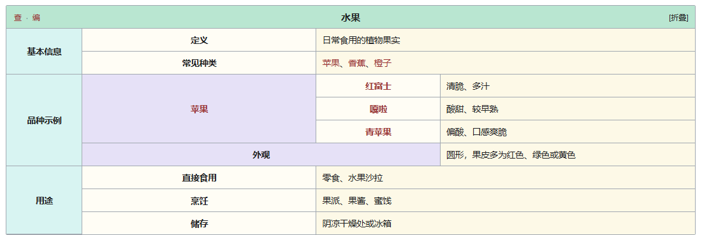

# Wiki Navbox

[English](README.md) | [简体中文](README.zh-CN.md)

在 Obsidian 笔记中嵌入一张类似维基百科条目页的折叠导航框：**查 · 编**（“论”默认收起）、两级分组、`[[双链]]`、明暗主题，以及按代码块记忆的折叠状态。



[完整页面预览](docs/preview-light.png) · [深色主题](docs/navbox-dark.png)

## 功能

- **仿维基百科导航表**：薄荷绿标题栏、章节色块、分组列、条目列与内容列。
- **两级层级**：章节 → 分组 → 行，自动计算 `rowspan`，适合分类、索引、关系梳理等知识库。
- **完整 Markdown**：单元格里的 `[[双链]]`、外部链接、粗体、行内代码都交给 Obsidian 原生渲染器处理。
- **图片自适应**：单元格、标题和 footer 支持 Markdown 图片与 Wiki 图片嵌入，并自动限制在列宽内。
- **头部操作**：
  - 查：打开当前笔记的阅读视图并回到顶部；
  - 编：切到当前笔记的源码模式；
  - 论：默认隐藏；开启后打开同级目录下的《笔记名（讨论）》，不存在时自动创建。
- **折叠状态记忆**：每个代码块单独记忆，也可用 `collapsed` 固定初始状态。
- **六套配色**：`mint`、`sky`、`lilac`、`rose`、`amber`、`slate`，自动适配 Obsidian 明暗主题。
- **中英双语**：设置页可切换“自动 / English / 简体中文”，导航框按钮、提示和错误信息同步切换。
- **设置即时生效**：切换默认配色、紧凑模式、链接颜色或头部按钮后，所有已打开的导航框就地重绘；也可以运行“刷新所有导航框”命令。
- **移动端可用**：窄屏下保留完整表格并横向滚动，不破坏层级。
- **无网络请求**：不收集、不上传任何笔记内容。

## 安装

### 方式一：从 GitHub Releases 分别下载三个文件（推荐）

打开仓库的 **Releases** 页面，进入最新版本，分别下载以下三个文件：

- `main.js`
- `manifest.json`
- `styles.css`

在你的仓库中创建这个文件夹，并把三个文件放进去：

```text
<你的仓库>/.obsidian/plugins/wiki-navbox/
├── main.js
├── manifest.json
└── styles.css
```

不要修改文件名。重启 Obsidian（或在“设置 → 第三方插件”中重新加载），启用 **Wiki Navbox**。

Release 页面直接提供三个独立文件，不需要解压压缩包。

### 方式二：复制构建目录

用于本地开发时，把仓库中的 [`dist/wiki-navbox`](dist/wiki-navbox) 整个文件夹复制到同一位置。

### 方式三：使用演示仓库

用 Obsidian 的“打开文件夹作为仓库”打开 [`demo-vault`](demo-vault)，再打开自带的示例笔记。该仓库已经放好插件并写入启用列表；如果 Obsidian 处于受限模式，请在“设置 → 第三方插件”中关闭受限模式并启用插件。

## 快速开始

在任意 Markdown 笔记里插入：

````markdown
```wiki-navbox
title: "水果"
groups:
  - label: "基本信息"
    rows:
      - [定义, 可食用的植物果实]
      - [常见种类, "[[苹果]]、[[香蕉]]、[[橙子]]"]
  - label: "品种示例"
    groups:
      - label: "苹果"
        rows:
          - [口感, 清脆、多汁]
```
````

阅读视图会渲染成导航表；源码模式仍显示原始 YAML，方便修改。

也可以使用命令 **Wiki Navbox: 插入导航框模板**。如果当前选中了文字，会把它当作标题；否则使用当前笔记名。

完整中文示例见 [水果.md](examples/水果.md)。

## 在其他笔记中引用（嵌入）

可以。这里要用 Obsidian 的**嵌入语法** `![[ ]]`，而不是普通链接 `[[ ]]`：

- `[[水果#导航]]`：普通链接，点击后跳到《水果》。
- `![[水果#导航]]`：把《水果》中“导航”标题下的内容直接渲染到当前页。

### 推荐做法：在主题页里嵌入标题

先在主题页中给导航框一个标题：

````markdown
## 导航

```wiki-navbox
title: "[[水果]]"
groups:
  - label: "分类"
    rows:
      - [常见种类, "[[苹果]]、[[香蕉]]、[[橙子]]"]
```
````

然后在其他页面写：

```markdown
![[水果#导航]]
```

这样其他页面会显示同一张导航框，源笔记修改后所有引用处自动更新，不需要复制 YAML。上面的写法可以直接复制到任意页面；完整示例见 [嵌入示例.md](examples/嵌入示例.md)。

### 独立导航片段

如果不想让导航框出现在主题正文里，也可以单独建一篇只有导航框的笔记，例如 `导航/水果.md`，然后整篇嵌入：

```markdown
![[导航/水果]]
```

整篇嵌入不会额外显示章节标题；同名笔记较多时写完整路径，路径不需要 `.md` 后缀。

> 如果嵌入位置只显示链接或占位符，请确认当前处于阅读视图 / 实时预览，并且 Wiki Navbox 已经启用；源码模式只会显示 `![[...]]` 原文。

### 嵌入后的“查 / 论 / 编”

嵌入内容以**源笔记**为上下文：

- 点“编”会编辑源笔记里的 YAML，正好适合集中维护导航框；
- 所有内部链接也相对源笔记解析，建议使用全库唯一的笔记名；
- 如果使用独立片段，又希望“查 / 论”跳到主题页，可显式指定：

```yaml
links:
  view: "水果"
  talk: "水果（讨论）"
  edit: "https://example.com/fruit"
```

不写 `links.edit` 时，“编”仍然会打开并编辑承载导航框的源笔记。

## 语法

### 缩进规则

YAML 的缩进**只能用空格，不能用 Tab**。本文所有示例统一使用 **每层 2 个空格**：

| 位置 | 前导空格 |
| --- | --- |
| 顶层 `groups:` | 0 |
| 章节项 `- label:` | 2 |
| 章节里的 `rows:` | 4 |
| 章节里的行 `- ["标签", "内容"]` | 6 |
| 二级分组项 `- label:` | 6 |
| 分组里的 `rows:` | 8 |
| 分组里的行 `- ["标签", "内容"]` | 10 |

```yaml
groups:
  - label: "基本信息"        # 2 个空格
    rows:                   # 4 个空格
      - [定义, 内容]         # 6 个空格
  - label: "品种示例"        # 2 个空格
    groups:                 # 4 个空格
      - label: "苹果"        # 6 个空格
        rows:               # 8 个空格
          - [口感, 内容]     # 10 个空格
```

- `label:` 直接写在 `- ` 后面，不需要再单独缩进一层。
- `rows:` 比它所在的层级多 2 个空格，`rows:` 下面的行再多 2 个空格。
- YAML 只要求同层对齐、子层比父层深；本插件文档统一使用 2 个空格，建议直接照抄。
- 如果 Obsidian 的 Tab 键插入的是制表符，请在“设置 → 编辑器”中关闭“使用 Tab 缩进”，让 Tab 自动变成空格。

### 章节与行

`groups` 是必填数组。每个章节可以有 `rows`（直接行）或 `groups`（二级分组）。

```yaml
title: "水果"
accent: mint
collapsed: false
groups:
  - label: "基本信息"
    rows:
      - ["定义", "可食用的植物果实"]
      - ["常见种类", "[[苹果]]、[[香蕉]]、[[橙子]]"]

  - label: "品种示例"
    groups:
      - label: "[[苹果]]"
        rows:
          - ["[[红富士]]", "甜脆、多汁"]
          - ["[[嘎啦]]", "酸甜、较早熟"]
      - label: "外观"
        value: "圆形，果皮多为红色或绿色"
```

### 行可以怎么写

| 写法 | 结果 |
| --- | --- |
| `[标签, 内容]` | 标签 + 内容 |
| `{ label: 标签, value: 内容 }` | 同上，适合内容含逗号时 |
| `{ value: 内容 }` | 内容横跨标签列，没有行标签 |
| `"一段内容"` | 内容横跨整行 |

数组和对象可以混用。空行、空对象会被忽略。

### 两级分组

`品种示例` 这类章节可以包含 `groups`；分组里再放 `rows` 或一个 `value`：

- 有 `rows` 的分组：分组名纵向合并，行标签独占一列。
- 只有 `value` 的分组：分组名横跨两列，内容从最右侧开始，适合“外观”这种摘要行。

目前只支持两级分组（章节 → 分组 → 行）。继续在分组里嵌套 `groups` 会得到一条明确的错误提示。

### 字段

| 字段 | 类型 | 默认 | 说明 |
| --- | --- | --- | --- |
| `title` | 文本 | `导航框` | 标题，可写 `[[双链]]` 或行内 Markdown |
| `groups` | 数组 | 必填 | 章节列表 |
| `accent` | 文本 | 设置中的默认配色 | `mint` / `sky` / `lilac` / `rose` / `amber` / `slate` |
| `collapsed` | 布尔 | 设置中的默认值 | `true` 初始折叠；不写则记住上次状态 |
| `dense` | 布尔 | `false` | 该表格使用紧凑间距 |
| `footer` | 文本 | 无 | 表格底部的小字，可写 Markdown |
| `links` | 对象 | 自动 | 自定义头部操作；`talk: true` 可单独开启“论” |
| `sections` | 数组 | 无 | `groups` 的别名 |

### 自定义头部操作

默认标题栏只显示 **查 · 编**，“论”默认隐藏。可以在设置中开启“论”，也可以只给某个代码块开启：

```yaml
links:
  view: "水果"
  talk: true
  edit: "https://example.com/fruit"
```

`links.talk` 的优先级：

- `true`：显示自动讨论页按钮，即使全局默认隐藏；
- `false`：始终隐藏，即使全局开启；
- 笔记路径：显示并跳转到指定讨论页；
- 不写：跟随设置中的“显示‘论’按钮”。

- 以 `http://`、`https://`、`mailto:` 开头的值会作为外部链接打开。
- 其他值会交给 Obsidian 的链接系统，支持笔记路径和 `#标题`。
- 不写 `links` 时，“查”和“编”使用自动行为，“论”跟随全局设置。

### 插入图片

单元格、标题和 footer 都会经过 Obsidian 的 Markdown 渲染器，可以直接使用图片语法。**整段内容必须用双引号包住**，否则 YAML 会把开头的 `!` 当作标签：

```yaml
- [Wiki 图片, "![[苹果.png]]"]
- [Wiki 图片（指定宽度）, "![[苹果.png|300]]"]
- [Markdown 图片, ""]
```

- 图片会自动缩放到单元格宽度并保持比例。
- 不加引号时，`![[...]]` 会被 YAML 解析成数组，插件会提示“请用双引号包住整段内容”。
- 图片路径遵循 Obsidian 的附件解析规则；跨文件夹时建议写完整路径。

### 配色

```yaml
accent: sky
```

| 名称 | 气质 |
| --- | --- |
| `mint` | 薄荷绿 + 淡青 + 淡紫，默认，最接近维基百科 |
| `sky` | 天蓝 |
| `lilac` | 淡紫 |
| `rose` | 玫瑰 |
| `amber` | 琥珀 |
| `slate` | 石板灰 |

## 命令

| 命令 | 说明 |
| --- | --- |
| `插入导航框模板` | 在光标处插入一份可直接修改的 YAML 模板 |
| `折叠 / 展开当前笔记中的所有导航框` | 批量切换当前笔记里的所有导航框 |
| `刷新所有导航框` | 重新渲染所有已打开的导航框，作为自动刷新失效时的手动兜底 |

## 设置

修改以下外观设置后，所有已打开的导航框会立即重绘，不需要切换文档：

- **语言**：自动跟随 Obsidian，或手动选择 English / 简体中文；设置页和已打开的导航框立即更新，命令名称需要重载插件后更新。
- **默认配色**：代码块未写 `accent` 时使用；代码块里显式写了 `accent` 的仍以代码块为准。
- **紧凑模式**：更小的内边距和字号。
- **使用主题链接颜色**：默认是维基风格的红褐色链接；打开后跟随当前主题。
- **显示头部操作**：总开关；关闭后保留标题和折叠按钮。
- **显示“论”按钮**：默认关闭，标题栏只显示“查 · 编”；开启后所有导航框显示讨论页入口。

其余行为设置：

- **默认折叠**：可被单个代码块的 `collapsed` 覆盖。
- **记住折叠状态**：按代码块保存在本地 `localStorage`。
- **自动创建讨论页**：仅在“论”可用时生效；关闭后，点击“论”只提示讨论页路径，不创建文件。

如果设置修改后没有自动刷新，可以运行命令 **刷新所有导航框**。

## 开发

```bash
npm install
npm run typecheck
npm test
npm run build
```

- `npm run build`：类型检查 → 构建 `main.js` → 同步 `dist/wiki-navbox`、`demo-vault` 和 `preview/demo.js`。
- `npm run dev`：监听 `src/` 和 `styles.css`，自动重建。
- `npm test`：解析器与示例笔记的单元测试。
- `npm run preview`：只重建预览，不跑类型检查。

浏览器预览：直接打开 [`preview/index.html`](preview/index.html)。加上 `?theme=light` 或 `?theme=dark` 可只看单一主题。

### 发布 Release

创建一个与 `manifest.json` 版本一致的 GitHub Release（例如 `1.0.0`），并**分别**上传以下三个文件：

```text
dist/wiki-navbox/main.js
dist/wiki-navbox/manifest.json
dist/wiki-navbox/styles.css
```

不要上传 zip 压缩包。在 GitHub 上使用 **Releases → Draft a new release**，逐个添加这三个文件。

GitHub 仍会自动显示 **Source code (zip)** 和 **Source code (tar.gz)**，它们是仓库源码快照，不是插件安装包，忽略即可。

使用 GitHub CLI：

```bash
gh release create 1.0.0 dist/wiki-navbox/main.js dist/wiki-navbox/manifest.json dist/wiki-navbox/styles.css --title "Wiki Navbox 1.0.0" --notes "Initial release."
```

### 目录

```text
src/
  main.ts         插件入口、命令、设置页、查/论/编行为
  model.ts        YAML 对象规范化与校验
  render.ts       表格、折叠、头部操作、错误 UI
  render-child.ts 单个导航框的渲染实例与设置变化重绘
  types.ts        模型与默认设置
  template.ts     插入模板
styles.css      插件样式
preview/        独立浏览器预览（复用真实渲染代码）
examples/       示例笔记
demo-vault/     可直接用 Obsidian 打开的演示仓库
dist/           可安装的插件目录
```

## 说明与限制

- 代码块使用 YAML；含 `[[`、`:`、`#` 的字符串建议用双引号包起来。
- 表格列宽固定为 11% / 34% / 18% / 37%，以贴近参考图；单元格内容会自动换行。
- 启用“论”后，默认创建同级目录下的 `笔记名（讨论）.md`，不会自动创建文件夹。
- 单元格内的 Markdown 由 Obsidian 的 `MarkdownRenderer` 渲染；插件不会读取或上传笔记内容。
- 最小支持 Obsidian 1.4.0。

## License

MIT
